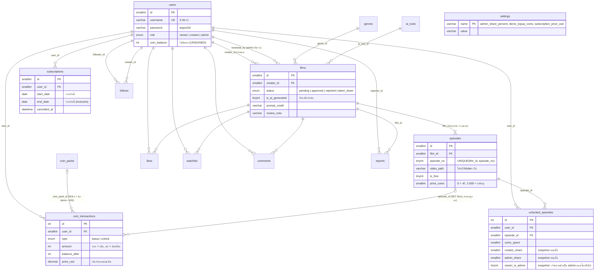

# ER diagram และกติกาข้อมูล

ตรงกับ `backend/db/shortreel.sql` (ติดตั้งใหม่) และ migration `001`–`002` (ฐานเดิม) ณ ตอนนี้ แสดงผลได้ใน GitHub, VS Code (Markdown Preview Mermaid) หรือ <https://mermaid.live>

> `settings` ไม่มี FK; `likes`, `watchlist`, `follows` ใช้ PK คู่ (ไม่ซ้ำ); `reports.status` = `open | resolved`; `comments` เป็นแบบเรียบ

## PK / FK / UNIQUE ที่ใช้ตรวจกติกา

| ตาราง | PK | FK (ON DELETE) | UNIQUE / หมายเหตุ |
|---|---|---|---|
| `users` | `id` | — | `username` |
| `films` | `id` | `creator_id → users` (CASCADE), `genre_id`, `ai_tool_id`, `reviewed_by → users` (SET NULL) | `status` เป็น enum 4 สถานะ |
| `episodes` | `id` | `film_id → films` (CASCADE) | **`UNIQUE(film_id, episode_no)`** เลขตอนไม่ซ้ำในหนังเดียวกัน (เลขไม่ต้องต่อเนื่อง) |
| `coin_transactions` | `id` | `user_id` (CASCADE), `coin_pack_id` (SET NULL), `episode_id` (SET NULL) | ledger แบบ append-only |
| `unlocked_episodes` | `id` | `user_id`, `episode_id` (CASCADE ทั้งคู่) | **`UNIQUE(user_id, episode_id)`** ซื้อซ้ำไม่ได้ |
| `subscriptions` | `id` | `user_id` (CASCADE) | ช่วงวันของแผนเดียวกันผู้ใช้ไม่ทับกัน (ดูด้านล่าง) |

Cardinality: ผู้ใช้ 1 คนมีได้หลายหนัง (เฉพาะ creator/admin), หนัง 1 เรื่องมีหลายตอน (≥ 1 ถึงจะ approve ได้), ผู้ใช้ 1 คนปลดล็อกแต่ละตอนได้ครั้งเดียว

## กติกาที่ระบบใช้จริง

**สถานะ review** (`films.status`): `pending → approved | rejected`, `approved → taken_down`, `rejected → approved`, `taken_down → approved` เท่านั้น. เฉพาะ `approved` อยู่ใน feed/search/`/stream` สำหรับคนทั่วไป; เจ้าของและ admin เห็นทุกสถานะ. เจ้าของแก้หนังที่ approved/rejected แล้วกลับเป็น `pending`

**ราคาฟรี/เหรียญ**: `is_free = 1` คู่กับ `price_coins = 0`; ตอนเสียเงินราคา 1–500 เหรียญ (API ปฏิเสธ 501+ และหน้า Upload จำกัดเท่ากัน). แก้ราคาทีหลังไม่กระทบผู้ที่ซื้อไปแล้ว

**ยอดคงเหลือ**: `users.coin_balance` เป็น `UNSIGNED` และการหักใช้ `UPDATE ... SET coin_balance = coin_balance - ? WHERE id = ? AND coin_balance >= ?` จึงไม่มีวันติดลบ (ไม่พอ → 402 ไม่เปลี่ยนอะไร). ทุกการเปลี่ยนยอดมีแถวใน `coin_transactions` พร้อม `balance_after`

**การซื้อซ้ำ**: ใน DB transaction เดียว ล็อกแถวหนัง (shared) → ผู้ใช้ (`FOR UPDATE`) → ตอน (shared) แล้วค่อยหัก/บันทึก; ถ้ามีแถว `unlocked_episodes` อยู่แล้วตอบ `charged: 0` ไม่หักซ้ำ. ล็อกหนังตัวเดียวกับที่คำสั่งลบตอน/หนังใช้ จึงไม่เกิดกรณีถูกหักเหรียญแล้วสิทธิ์หายเพราะตอนถูกลบพร้อมกัน (ลบไม่ได้ถ้ามีคนจ่ายแล้ว → 409)

**ส่วนแบ่งรายได้**: `creator_share = floor(coins × (100 − admin_percent) / 100)`, `admin_share = coins − creator_share` (ผลรวมเท่าเหรียญเสมอ). หนังของ admin: `creator_share = 0`, `admin_share = ทั้งหมด`. **บันทึกลงแถว `unlocked_episodes` ตอนปลดล็อก** พร้อม `owner_is_admin` ณ เวลานั้น ดังนั้นการเปลี่ยน `admin_share_percent` หรือเปลี่ยน role ของเจ้าของภายหลังไม่เปลี่ยนรายได้ย้อนหลัง (มี regression test)

ตัวอย่าง: ราคา 30 เหรียญ, admin 30% → creator 21, admin 9. เปลี่ยนเป็น 50% ภายหลัง → รายการเดิมยัง 21/9, รายการใหม่ 15/15

**Subscription**: วันที่เป็น *inclusive ทั้งสองด้าน* แผนที่ซื้อวัน D ครอบคลุม D ถึง (D + 1 เดือน − 1 วัน). ซื้อซ้ำตอนมีแผนที่จ่ายล่วงหน้าไว้แล้ว แผนใหม่เริ่มวันถัดจาก `MAX(end_date)` ของแผนที่ยังไม่หมด จึงไม่ทับกันกี่ครั้งก็ตาม (รวมกรณีซื้อพร้อมกัน เพราะล็อกแถวผู้ใช้). `GET /subscription` ตอบ `today`, `paid_through`, `plans_remaining` จากเซิร์ฟเวอร์

## Acceptance cases (มี test รองรับใน `backend/test/`)

| กรณี | ผลที่ต้องได้ | Test |
|---|---|---|
| ปลดล็อกตอน 20 เหรียญ ผู้ใช้มี 50 | balance 30, `unlocked_episodes` 1 แถว, ledger −20 | wallet.test.js |
| ปลดล็อกซ้ำ | `charged: 0`, balance เท่าเดิม, ไม่มีแถวใหม่ | wallet.test.js |
| เหรียญไม่พอ | 402, ไม่มีแถวใหม่, balance เท่าเดิม | wallet.test.js |
| ปลดล็อกพร้อมกันหลายคำขอ | หักครั้งเดียว | wallet.test.js |
| ลบตอนพร้อมกับปลดล็อก (ทั้งสองลำดับ) | หรือ unlock 200 + ลบ 409 หรือ ลบ 204 + unlock 404 ไม่หักเหรียญ | sprint12_regressions.test.js |
| เปลี่ยน role เจ้าของหนังหลังมีคนซื้อ | รายได้ย้อนหลังเท่าเดิม | sprint12_regressions.test.js |
| ซื้อ Plus 5 ครั้ง (รวมพร้อมกัน) | ช่วงวันต่อเนื่อง ไม่ทับ | sprint12_regressions.test.js |
| ราคา 501 | 400 | sprint12_regressions.test.js |

## ติดตั้งใหม่ กับ ฐานเดิม

- **ติดตั้งใหม่ (ล้างข้อมูล):** `backend/db/shortreel.sql` มี `DROP DATABASE IF EXISTS` และสร้างทุกตาราง + seed ครบทุกคอลัมน์ ห้ามใช้กับฐานที่มีข้อมูลจริง
- **ฐานเดิม:** ไม่มี migration แล้ว ใช้ `shortreel.sql` สร้างใหม่ (คอลัมน์ `owner_is_admin`, `bio`, `price_usd`, `cancelled_at`, `created_at` รวมอยู่ในไฟล์นี้แล้ว)
